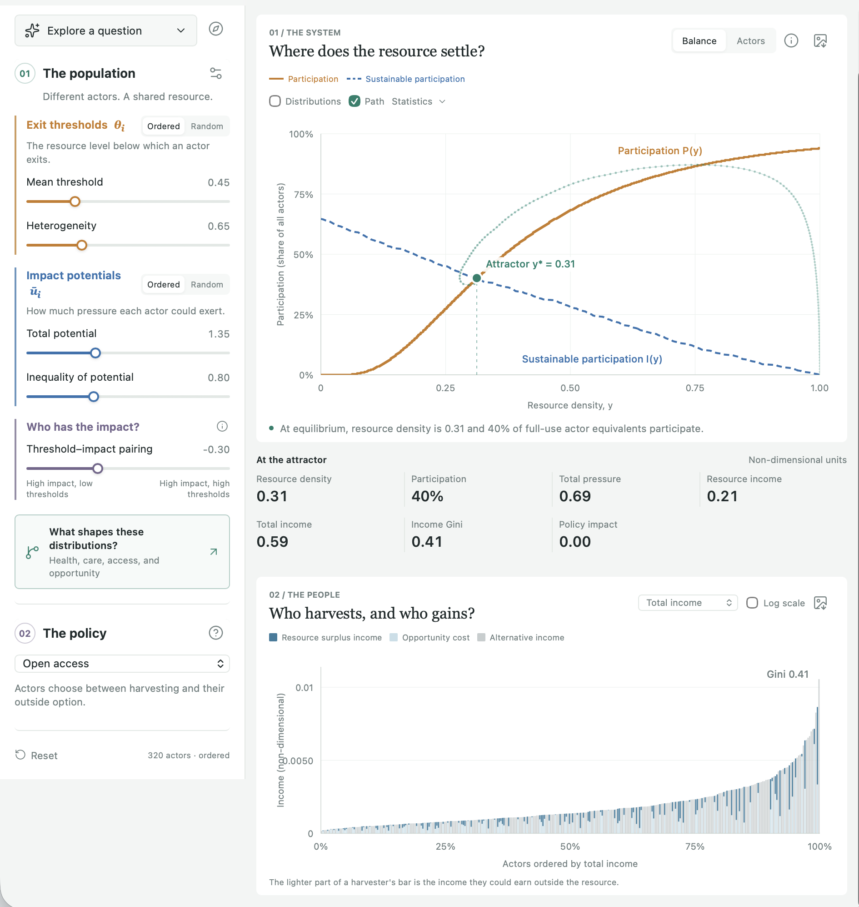

# SED

## Who exits, who extracts, who gains?

**A distributional model of resource use and governance.**

Two communities can have the same average incomes and harvesting technology,
yet different resource futures. What matters is how outside opportunities and
extraction potential are distributed, and **whether the actors with the greatest
impact are the first to leave or the last to remain**.

SED connects those differences to resource dynamics and the distribution of
policy costs and benefits. This repository contains the Julia model, an
interactive browser companion, and the sources and numerical records for the
accompanying theoretical paper.

### Explore the Model

**[Launch the interactive companion](https://zahachtah.github.io/SED/)**

Manuscript (pending approval) · Supplementary material (pending approval)

<!-- companion-screenshot -->
[](https://zahachtah.github.io/SED/)

The companion runs in your browser. No account, installation, or server is
needed. For offline use, download the repository and open `index.html`.
It makes no requests to a numerical backend and includes its own scripts,
styles, and icons.

### Questions to Try

- **Same averages, different outcomes:** change threshold heterogeneity while
  keeping the mean fixed.
- **Who has the impact?** Reverse the threshold-impact pairing while retaining
  both marginal distributions, then compare the resource attractors.
- **Same resource recovery, different beneficiaries:** compare equal and
  historical use rights, and switch between income levels and income changes.
- **How much policy?** Scan an instrument to compare ecological, income, and
  inequality outcomes across its strength.
- **Where do the distributions come from?** Open the population builder to
  explore illustrative links from health, gendered access, care obligations,
  and capital to time, efficiency, and outside opportunities.

The population builder illustrates possible mechanisms; it is not an empirical
claim about any social group. Applying it to a particular context requires
data and defensible causal assumptions.

## How It Works

Each actor has two non-dimensional quantities:

| Quantity | Interpretation |
| --- | --- |
| Exit threshold, `θᵢ` | The resource density below which harvesting is no longer worthwhile. Outside opportunities can include constraints and obligations. |
| Impact potential, `ūᵢ` | Maximum extraction pressure relative to ecological renewal. |

Ordering actors by exit threshold produces a **participation curve** and a
**sustainable-participation curve**. One describes participation driven by
harvesting incentives; the other gives the participation needed to balance
resource renewal, using that same actor order. Their crossing determines the
resource attractor, including partial activity by a marginal actor when needed.

Two comparisons motivate the framework: changing the pairing can change the
attractor without changing either marginal distribution; policies with the
same resource outcome can distribute income very differently.

The Julia package integrates actor use and resource dynamics directly. Policies
change thresholds, impact potentials, access, or rent allocation. See the
[model-to-paper crosswalk](docs/model-paper-crosswalk.md) for equations,
notation, and implementation details.

## Run a Study in Julia

The recorded environment uses **Julia 1.12.5**. From the repository root:

```sh
julia --project=. -e 'using Pkg; Pkg.instantiate(); Pkg.test()'
```

```julia
using SED

population = base(N=300)
sample!(population; random=false)
open_access = sim(population)

rights = scenario(population;
    policy="Tradable Use Rights", policy_target=:effort)
managed = sim(rights; regulation=0.40, start_from_OA=true)

outcomes = incomes(managed)
```

Here, `regulation=0.40` sets the aggregate effort quota to `0.60`.
Both runs retain the same actor population; the policy begins at its open-access
attractor. `random=false` uses deterministic ordered quantiles. For random
studies, set and report an RNG seed before sampling.

Plot the results with CairoMakie:

```julia
using CairoMakie
CairoMakie.activate!()

fig = Figure(size=(1100, 750))
phase_plot!(Axis(fig[1, 1]), managed; show_trajectory=true)
incomes_plot!(Axis(fig[2, 1]), managed; order=true)
save("outcomes.pdf", fig)
```

## Repository Map

| Directory | Contents |
| --- | --- |
| [`src/`](src/) | Julia distributions, dynamics, policies, metrics, and plotting. |
| [`test/`](test/) | Scientific regression tests. |
| [`webapp/`](webapp/README.md) | Companion source, standalone build, and numerical/browser checks. |
| [`manuscript/`](manuscript/README.md) | Main-figure source code and helpers. Manuscript and rendered figures pending approval. |
| [`SupplementaryMaterial/`](SupplementaryMaterial/README.md) | Supplementary numerical and figure-generation code. Documents and submission assets pending approval. |
| [`docs/`](docs/README.md) | Model conventions, distributions, policies, and reproduction instructions. |

Start with the [reproduction guide](docs/reproducibility.md) to regenerate the
paper's figures. To design a new study, read the [distribution guide](docs/distributions.md)
and [policy guide](docs/policies.md). Policies can be extended through
[Julia dispatch](docs/custom_policies.md). [AGENTS.md](AGENTS.md) records the
scientific conventions for AI-assisted work.

## Scientific Scope

The manuscript and supplementary material are pending approval for release.
The tested Julia model is the computational reference. The companion is checked against fixed-population
Julia runs. Its [scientific contract](webapp/SCIENCE.md) documents numerical
convergence, accounting, sampling, and reduced-form assumptions.

Exclusive rights use a binary strong-sanction specialization. Protected areas
use a one-resource equilibrium reduction, not an exact reproduction of two-patch
transients. Generic economic transforms require an explicit dimensional mapping
before being interpreted as a particular royalty or gear subsidy. Experimental
development and two-patch workflows are not exposed in the companion.

## Citation and License

By Jon Norberg and John M. Anderies. Please cite the software and identify the
version used while the accompanying paper is pending approval for release;
machine-readable metadata is in
[`CITATION.cff`](CITATION.cff). Record the exact commit or source-snapshot
identifier, Julia environment, population seed, policy settings, and convergence
diagnostics. Publication and archived-release DOIs will be added when available.

SED uses the [MIT license](LICENSE). Bundled Lucide icons retain their
[ISC license](webapp/vendor/lucide.LICENSE).
