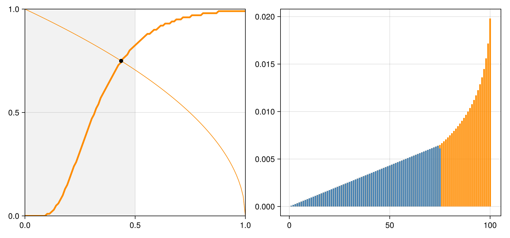
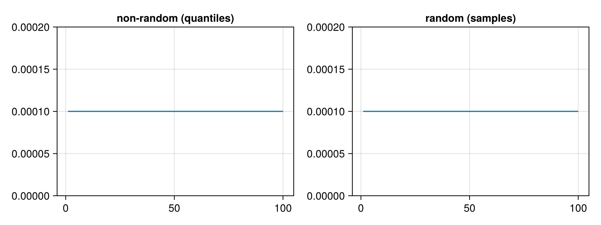

# SED — Socio‑economic/Social‑ecological Distributions

SED provides simple, composable distributions for agents and resources, plus simulation and plotting helpers for socio‑ecological models. It’s lightweight by default; plotting functions load when Makie is available.

Quick Start

```julia
include("SED.jl"); using .SED

N = 100
s = (
  N = N,
  q = dist(min=1/N, max=1/N, normalize=true),
  w = dist(min=0.2, max=0.4),
  K = 2.0,
  # deps inferred from the string; `independent` is the base vector
  w̃ = dist(min=0.1, max=1.0, dependency_fun = "q .* w ./ K .+ independent"),
  ū  = dist(dependency_fun = "q ./ w̃"),
)
sample!(s)   # resolves dependencies topologically

sol = sim(scenario(base(N=N); w̃=dist(data=s.w̃), ū=dist(data=s.ū)))
```

Policies (simple first)

```julia
# Start from a baseline
s = scenario(base(N=200))

# Apply a policy with a kit (recommended)
tur = with_policy(s; tradable_use_rights_kit(; target=:effort, market_rate=0.05)...)
R = regulation_scan(tur; m=50, warmstart=:chain)

# Or define it manually (set policy so extra state is added)
tur2 = scenario(s; policy="Tradable Use Rights",
  γ=γ_tradable_use_rights, ϕ=ϕ_tradable_use_rights, regulate=regulate_tradable_use_rights,
  policy_target=:effort, market_rate=0.05)
sol = sim(tur2; regulation=0.5)
```

Example output:



Learn More

- [Core](docs/core.md): concepts, contexts, simulation
- [Distributions](docs/distributions.md): independent/dependent, function vs string, sampling
- [Visualizations](docs/visualizations.md): phase, incomes, Γ and Φ, dependency graph
- [Policies](docs/policies.md): scenarios, regulation scan, evaluation
  - Why aggregate clamp for TUR supply and when to use warm‑starts

Plotting (optional)

```julia
import CairoMakie; CairoMakie.activate!()
fig = Figure(); ax = Axis(fig[1,1]); phase_plot!(ax, sol); display(fig)
gfig = dependency_graph_plot(s); display(gfig)
```

Figures

- README: `julia --project examples/readme_figures.jl` → `examples/figures`
- Manuscript: `julia --project manuscript/figures.jl` → `manuscript/figures`

Dependency graph (README example):


Sampling compare (non‑random vs random):



Γ and Φ curves (README example):


sample! Overrides

```julia
sample!(s, :q; N=50)       # realize one param at length 50
sample!(s; N=50)           # whole context at length 50
sample!(s; random=true)    # force random sampling for this call
```

Core API

- `dist`, `sample!` (per Dist, per param, whole context; `N`, `random` overrides)
- `scenario`, `base`/`high_impact`/`low_impact`/`high_incentives`
- `sim`, `incomes`, `gini`, `regulation_scan`, `dependency_graph`

Plotting API (loads when Makie is available)

- `phase_plot!`, `phase_plot`, `incomes_plot!`, `dependency_graph_plot`
- Components: `Γ_plot!`, `Φ_plot!`, `attractor_plot!`, `trajecory_plot!`, `bg_plot!`, `target_plot!`
