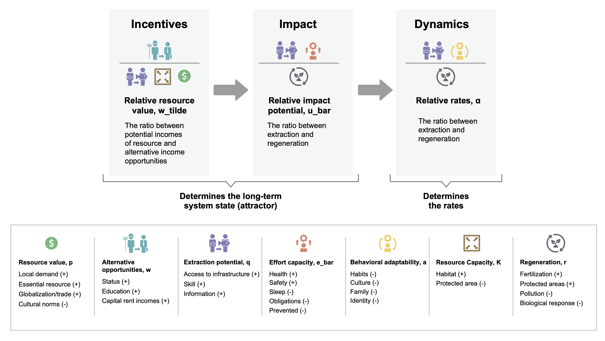
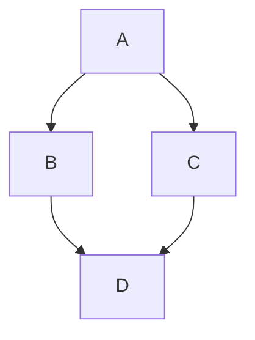
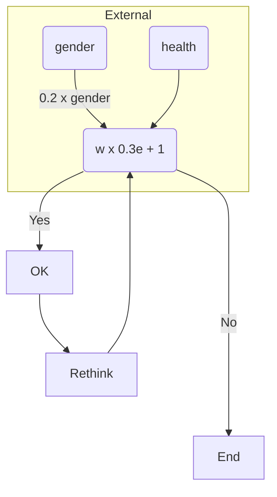
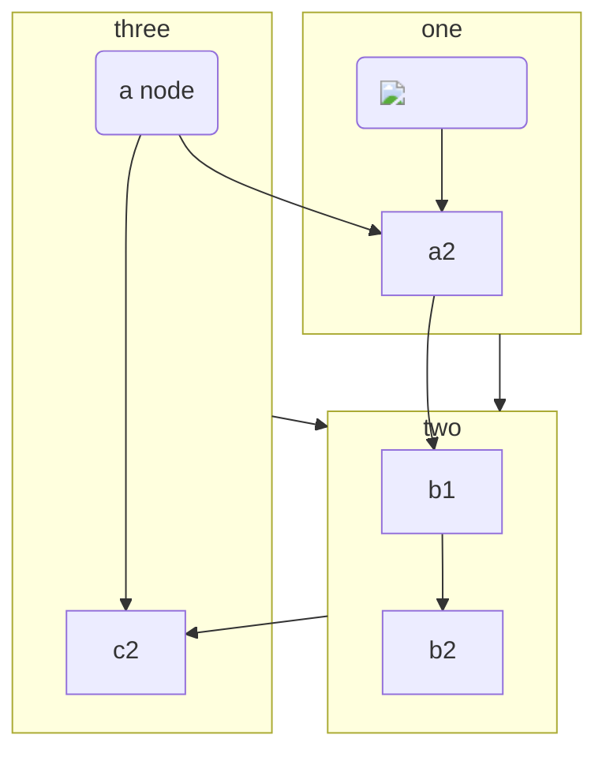
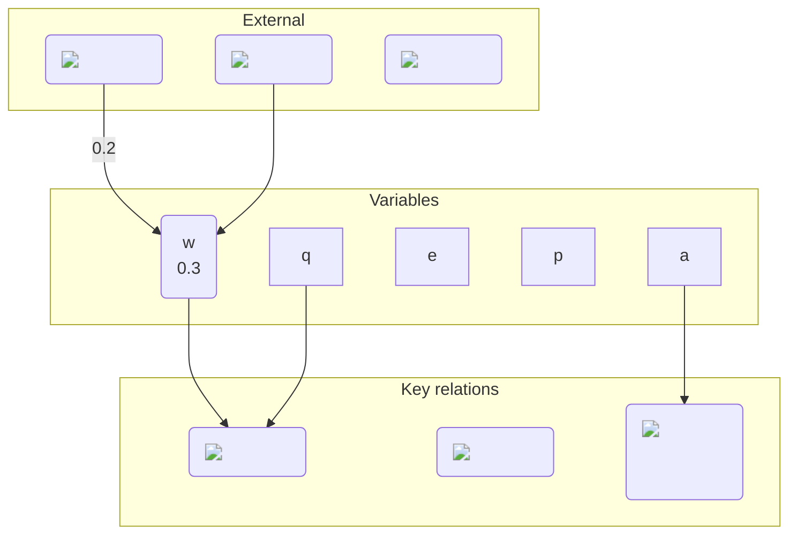

# SED: (Socio-economic || Social-ecological) diversity
## Parameters as distributions
## Resource use scenarios

I am writing {:height="30px" width="30px"}
## Governance

U=int(u\bar * y>w\tilde ? 1 : 0)
S=int(u\bar * 1-y>w\tilde ? 1 : 0)

